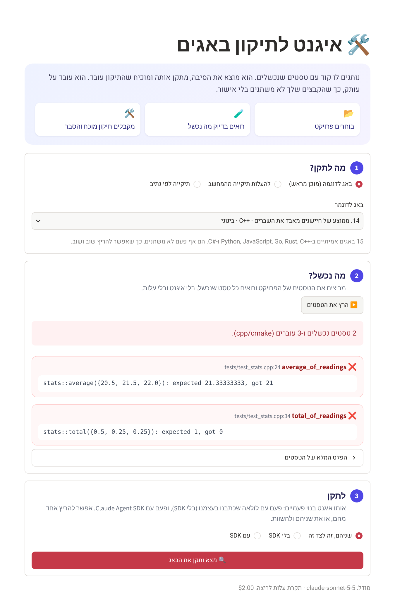
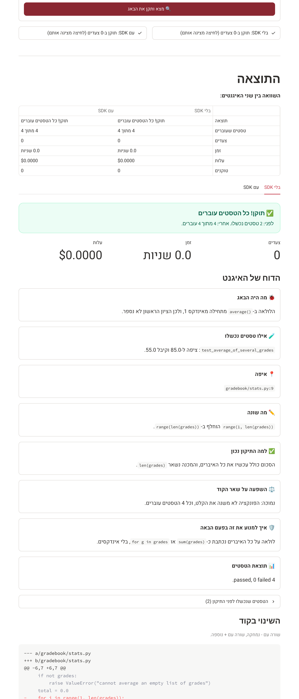

<div dir="rtl">

# bugfix-agent: איגנט שמתקן באגים

[English](README.en.md) · עברית

נותנים לו פרויקט שיש בו טסטים שנכשלים. הוא:

1. מוצא את הסיבה לבאג,
2. מתקן אותה בשינוי הכי קטן שאפשר,
3. מוכיח שהתיקון עובד, על ידי הרצת כל הטסטים,
4. ומראה לך בדיוק מה הוא שינה, **לפני** שהוא נוגע בקבצים שלך.

אותו איגנט בנוי **פעמיים**, על אותו בסיס משותף, כדי שאפשר יהיה להשוות ביניהם שורה מול שורה:

- **בלי SDK** (התיקייה `raw_agent/`): מדבר עם Claude בעצמו, ישירות דרך האינטרנט, עם לולאה שכתבנו לבד.
- **עם SDK** (התיקייה `sdk_agent/`): משאיר את הלולאה ל-Claude Agent SDK.

ההשוואה המלאה בין שניהם נמצאת ב-[COMPARISON.he.md](COMPARISON.he.md).
מדריך שימוש מפורט, צעד אחר צעד, נמצא ב-[USAGE.he.md](USAGE.he.md).

## התחלה מהירה

צריך שני דברים:

- **Python בגרסה 3.11 ומעלה.**
- **מפתח API של Claude**, שיוצרים באתר console.anthropic.com.

פותחים טרמינל בתיקייה של הפרויקט הזה ומריצים את הפקודות לפי הסדר.

### ב-Windows

אם `python --version` מדפיס רק "Python" בלי מספר, כותבים `py` במקום `python`, כמו כאן:

</div>

```bat
py -m pip install -e .
setx ANTHROPIC_API_KEY "sk-ant-..."
```

<div dir="rtl">

אחרי `setx` סוגרים את הטרמינל ופותחים חדש, כדי שהמפתח ייקלט. ואז:

</div>

```bat
py -m cli ui
```

<div dir="rtl">

### ב-Mac או Linux

</div>

```bash
pip install -e .
export ANTHROPIC_API_KEY=sk-ant-...
bugfix ui
```

<div dir="rtl">

הפקודה האחרונה פותחת את האיגנט בדפדפן, בעברית. את המפתח לא כותבים בתוך הקוד ולא שולחים לאף אחד.

## הממשק בדפדפן

הדף בנוי משלושה שלבים:

1. **מה לתקן?** בוחרים אחת משלוש אפשרויות:
   - באג לדוגמה, מתוך 15 באגים שהכנו מראש, בשש שפות.
   - **העלאת תיקייה מהמחשב**: לוחצים, בוחרים את תיקיית הפרויקט, וזהו.
   - הקלדת הנתיב לתיקייה במחשב.
2. **מה נכשל?** הכפתור "הרץ את הטסטים" מראה כל טסט שנכשל: השם שלו, הקובץ והשורה, ומה הוא
   ציפה לקבל לעומת מה שקיבל. זה לא עולה כסף.
3. **לתקן:** בוחרים איגנט (בלי SDK, עם SDK, או שניהם זה לצד זה) ולוחצים **מצא ותקן את הבאג**.



בזמן העבודה רואים כל צעד של האיגנט. בסוף רואים:

- האם הבאג תוקן: כמה טסטים נכשלו לפני, וכמה עוברים אחרי.
- **דוח בעברית**, מחולק לכרטיסים: מה היה הבאג, אילו טסטים נכשלו, איפה (קובץ ושורה), מה שונה,
  למה התיקון נכון, על מה עוד הוא יכול להשפיע, ואיך למנוע באג כזה בפעם הבאה.
- את השינוי המדויק בקוד: שורה עם `-` נמחקה, שורה עם `+` נוספה.
- כמה צעדים זה לקח, כמה זמן, וכמה זה עלה. כשמריצים את שני האיגנטים, יש טבלת השוואה ולשונית לכל אחד.



ואז:

- **אם העלית תיקייה:** מורידים את הפרויקט המתוקן כקובץ zip, או רק את השינוי.
- **אם הקלדת נתיב:** לוחצים על כפתור אחד, והתיקון נכתב לקבצים שלך.

בדף אין הגדרות לשנות. המודל והתקציב קבועים בקוד (ראו "הגדרות" למטה).

## בטרמינל, בלי דפדפן

מי שמעדיפה טרמינל צריכה רק שתי פקודות. ב-Windows כותבים `py -m cli` במקום `bugfix`.

</div>

```bash
bugfix check ./my-project      # מה נכשל? (בלי מפתח ובלי עלות)
bugfix fix ./my-project        # מוצא את הבאג, מראה את התיקון, ושואל לפני שהוא מחיל אותו
```

<div dir="rtl">

כך זה נראה:

</div>

```text
$ bugfix fix ./my-project
Fixing my-project with the raw agent (claude-sonnet-5-5)
Working on a private copy; your files are not touched yet.
Runner: python/pytest  |  2 failing, 14 passing
  > running tests
  > reading src/pricing.py
  thinking: The discount is applied before the tax, but the test expects ...
  > editing src/pricing.py
  > running tests

6 steps, 41s, about $0.0312
Fixed: all 16 tests pass on the agent's copy.

Proposed change:
--- a/src/pricing.py
+++ b/src/pricing.py
...
Apply this change to your project? [y/N]
```

<div dir="rtl">

עונים `y` כדי להחיל את התיקון, או Enter כדי לוותר. אם ויתרת, שום דבר לא השתנה.

כל שאר האפשרויות הן רשות:

| מה רוצים | פקודה |
|---|---|
| לראות מה נכשל, עם הפלט המלא של הטסטים | `bugfix check -v` |
| רק לראות את התיקון, בלי להחיל אף פעם | `bugfix fix --dry-run` |
| להחיל בלי לשאול (לסקריפטים) | `bugfix fix --yes` |
| להריץ את הגרסה שבנויה עם ה-SDK | `bugfix fix --engine sdk` |
| להגביל עלות, למשל לחצי דולר | `bugfix fix --max-cost 0.50` |
| לבחור מודל אחר | `bugfix fix --model claude-opus-5-5` |
| להוסיף מודל גיבוי, למקרה ש-Claude נכשל | `bugfix fix --fallback groq:<model>` |
| לעבוד רק עם מודל חינמי במחשב שלך | `bugfix fix --model ollama:<model>` |
| לשמור תיעוד של כל צעד לקובץ | `bugfix fix --trace run.jsonl` |
| לראות את כל ההערות של האיגנט | `bugfix fix -v` |
| לפתוח את הממשק בדפדפן | `bugfix ui` |
| להשוות את שני האיגנטים על 15 הבאגים | `bugfix benchmark` |

אם לא כותבים תיקייה, הכלי עובד על התיקייה הנוכחית.

## באילו שפות זה עובד

האיגנט עצמו לא תלוי בשפה. רק הרצת הטסטים תלויה בשפה, והיא מזוהה לבד:

| שפה | איך מזהים | מה מריצים |
|---|---|---|
| Python | `pyproject.toml`, `setup.py`, `pytest.ini`, או קובץ `*.py` | `pytest` |
| JavaScript / TypeScript | `package.json` | `npm test`, או `node --test` |
| Go | `go.mod` | `go test ./...` |
| Rust | `Cargo.toml` | `cargo test` |
| Java / Kotlin | `pom.xml`, `build.gradle` | `mvn test`, `gradle test` |
| C / C++ | `CMakeLists.txt` | `cmake`, בנייה, ואז `ctest` |
| C# / .NET | קובץ `.sln` או `.csproj` | `dotnet test` |

הכלים של השפה צריכים להיות מותקנים במחשב שמריץ את האיגנט: למשל CMake ומהדר C++ (כמו
Visual Studio Build Tools ב-Windows), או .NET SDK ל-C#.

לכל שפה אחרת מוסיפים לפרויקט קובץ `bugfix.yaml` עם הפקודה שמריצה את הטסטים:

</div>

```yaml
test_command: "bundle exec rspec"
language: ruby          # רשות, מופיע בדוחות
```

<div dir="rtl">

## מודלים חינמיים כגיבוי

אם Claude נכשל באמצע (נגמר הקרדיט, מפתח לא תקין, תקלה בשרת), האיגנט שבלי SDK ממשיך אצל מודל
חינמי, **מאותה נקודה** ולא מההתחלה. כותבים את מודלי הגיבוי לפי הסדר:

</div>

```bash
bugfix fix --fallback groq:<model> --fallback ollama:<model>
```

<div dir="rtl">

מודל חינמי נכתב כך: `<שירות>:<שם המודל>`, והוא חייב לתמוך בהפעלת כלים (tool calling).

| שירות | מה זה | מפתח |
|---|---|---|
| `ollama` | רץ על המחשב שלך, חינמי לגמרי ובלי אינטרנט. מתקינים מ-ollama.com | לא צריך |
| `groq` | שירות בענן עם מסלול חינמי | `GROQ_API_KEY` |
| `openrouter` | שירות בענן. מודלים שהשם שלהם נגמר ב-`:free` הם בחינם | `OPENROUTER_API_KEY` |
| `gemini` | המודלים של Google, עם מסלול חינמי | `GEMINI_API_KEY` |

מודלים חינמיים בדרך כלל חלשים יותר מ-Claude במציאת באגים, ולכן הם מתאימים בעיקר כגיבוי.
זה עובד רק באיגנט שבלי SDK, כי ה-SDK של Claude עובד רק עם Claude. זה אחד ההבדלים שההשוואה מראה.

## למה אפשר לסמוך עליו

האיגנט יכול רק לראות אילו קבצים יש, לקרוא, לחפש, לערוך קבצים ולהריץ את הטסטים. אין לו טרמינל
חופשי, אין לו אינטרנט, ואין לו גישה לשום דבר מחוץ לעותק של הפרויקט. בנוסף:

- **הקבצים שלך לא משתנים בלי אישור.** הוא עובד על עותק זמני, ואת השינוי רואים קודם. אם שינית קובץ
  בזמן שהוא עבד, התיקון לא ידרוס את השינוי שלך.
- **אסור לו לגעת בטסטים.** הוא לא יכול לערוך קבצי טסט או הגדרות טסטים. אם משהו בהם השתנה בכל דרך
  שהיא, זה מתגלה והריצה נפסלת.
- **הוא לא בודק את עצמו.** בסוף, הטסטים רצים שוב באופן עצמאי, ורק התוצאה הזאת קובעת אם הבאג תוקן.
- **יש לו תקציב.** ברירת המחדל: עד 15 צעדים, 1.5 מיליון טוקנים ו-2 דולר לריצה.
- **הסודות שלך לא מגיעים לטסטים.** הטסטים רצים בלי מפתח ה-API ובלי שאר משתני הסביבה שלך.

מגבלה ידועה: טסטים שכתובים בתוך קובץ הקוד עצמו (למשל ב-Rust) אי אפשר להגן עליהם לפי שם הקובץ.
עדיין, ההרצה העצמאית בסוף היא שקובעת את התוצאה.

## הגדרות

לכל הגדרה יש ברירת מחדל, ומשנים אותה במשתנה סביבה שמתחיל ב-`BUGFIX_`:

| משתנה | מה הוא קובע | ברירת מחדל |
|---|---|---|
| `BUGFIX_MODEL` | המודל | `claude-sonnet-5-5` |
| `BUGFIX_FALLBACK_MODELS` | מודלי גיבוי, מופרדים בפסיק | אין |
| `BUGFIX_EFFORT` | כמה מאמץ המודל משקיע | `medium` |
| `BUGFIX_REPORT_LANGUAGE` | שפת הדוח של האיגנט | `Hebrew` |
| `BUGFIX_MAX_ITERATIONS` | מספר צעדים מקסימלי | `15` |
| `BUGFIX_MAX_COST_USD` | עלות מקסימלית לריצה, בדולרים | `2.0` |
| `BUGFIX_MAX_TOTAL_TOKENS` | מספר טוקנים מקסימלי | `1500000` |
| `BUGFIX_TEST_TIMEOUT_S` | כמה שניות מחכים לטסטים | `120` |

הרשימה המלאה נמצאת ב-`core/config.py`.

## איך הקוד בנוי

</div>

```text
cli/          הפקודה bugfix
ui/           הממשק בדפדפן: logic.py עושה את העבודה, app.py מצייר, texts.py מחזיק את כל הטקסטים
core/         כל מה ששני האיגנטים חולקים
  tools.py        חמשת הכלים: run_tests, list_files, read_file, search_code, edit_file
  sandbox.py      העותק הפרטי, שמירה שלא יוצאים ממנו, זמני ריצה, סביבה נקייה
  guards.py       טסטים לקריאה בלבד, זיהוי שינוי בטסטים, תקציבים
  languages.py    איך מריצים טסטים, סופרים תוצאות ומחלצים כל כישלון, לכל שפה
  cmake_steps.py  ב-C++: הגדרה, בנייה והרצת טסטים בפקודה אחת
  evaluation.py   הבדיקה העצמאית בסוף
  harness.py      מה שמסביב ללולאה: מצב התחלתי, עותק, תיקון, בדיקה, diff
  prompts.py      ההנחיות למודל, אותן הנחיות בדיוק לשני האיגנטים
raw_agent/    האיגנט בלי SDK
  client.py       תקשורת, הזדהות, סוגי שגיאות, ניסיונות חוזרים
  providers/      שכבת המודלים: Anthropic, מודלים חינמיים, שרשרת גיבוי
  loop.py         הלולאה של האיגנט
sdk_agent/    האיגנט עם Claude Agent SDK
  agent.py        הכלים שלנו ככלי MCP, בלי הכלים המובנים, טיפול בהודעות
benchmark/    15 באגים ב-Python, JavaScript, Go, Rust, C++ ו-C#, והכלי שמשווה בין האיגנטים
tests/        248 טסטים, ואף אחד מהם לא צריך מפתח API
```

<div dir="rtl">

שני האיגנטים מתחברים לאותה פונקציה, `run_case()` שבקובץ `core/harness.py`. ההבדל היחיד ביניהם
הוא הלולאה שמדברת עם המודל, וזה מה שהופך את ההשוואה להוגנת.

## ההשוואה בין שני האיגנטים

</div>

```bash
bugfix benchmark                                          # שני האיגנטים, 15 באגים, 3 פעמים כל אחד
bugfix benchmark --engine raw --cases 01 11 --repeats 1   # הרצה קטנה וזולה
```

<div dir="rtl">

התוצאה נכתבת לקובץ `benchmark/results/results.md`: כמה באגים תוקנו, כמה צעדים, כמה טוקנים, כמה
עלה וכמה זמן לקח, לכל איגנט ולכל באג. כל באג רץ כמה פעמים, כי מודל לא עונה בדיוק אותו דבר בכל
פעם. ההרצה המלאה עולה כמה דולרים.

הבאגים נעים בין טעות של אחד באינדקס, דרך באגים שמפוזרים על שני קבצים, ועד מלכודת עיגול שבה
התיקון המתבקש שובר טסטים אחרים. כל באג נבדק: הוא חייב להיכשל כמו שהוא, והתיקון הנכון חייב לעבור.

## הערות הסבר בעברית בקוד

כל שורה בקוד שמתחילה ב-`# 📘` היא הסבר בעברית, ללמידה. במקומות שבהם שני האיגנטים שונים, ההסבר
מסומן `[בלי SDK]` או `[עם SDK]`. כדי להגיש בלי ההסברים:

</div>

```bash
make strip-explanations
```

<div dir="rtl">

הפקודה מוחקת רק את שורות ההסבר. הקוד עצמו לא משתנה.

## למפתחים

</div>

```bash
pip install -e ".[dev]"
make check          # ruff, mypy --strict ו-pytest
```

<div dir="rtl">

הטסטים משתמשים ב-API מדומה, ולכן הם רצים בלי אינטרנט ובלי עלות.

</div>
